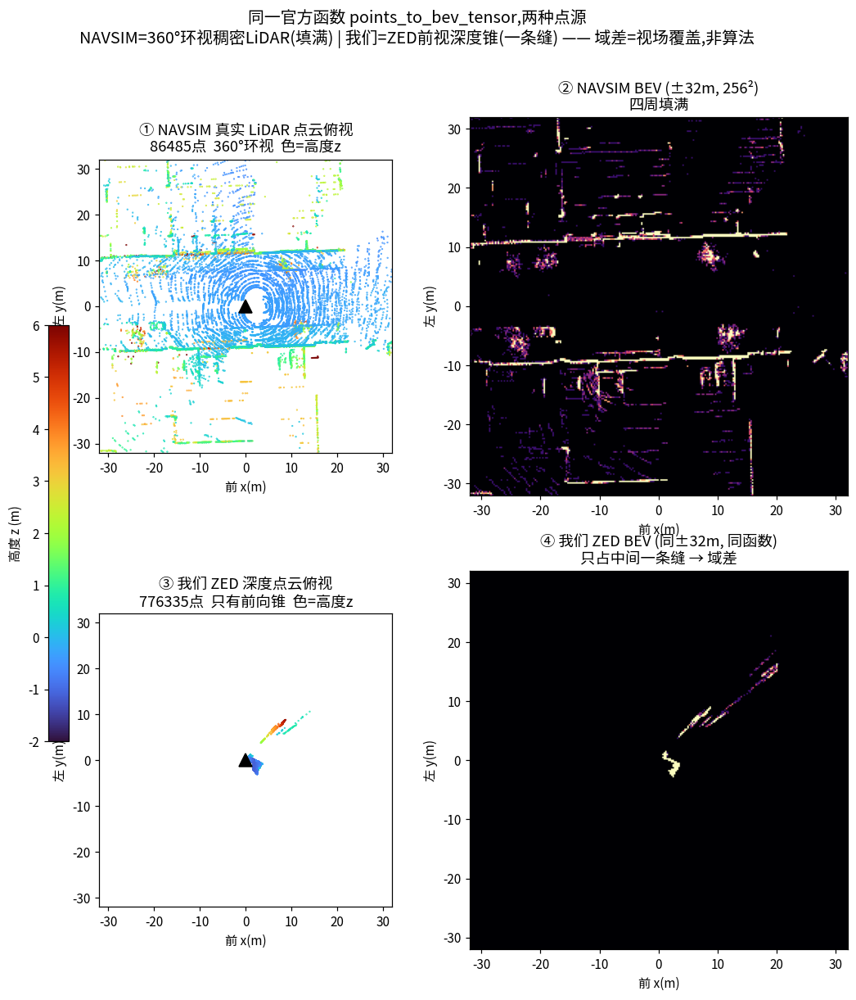
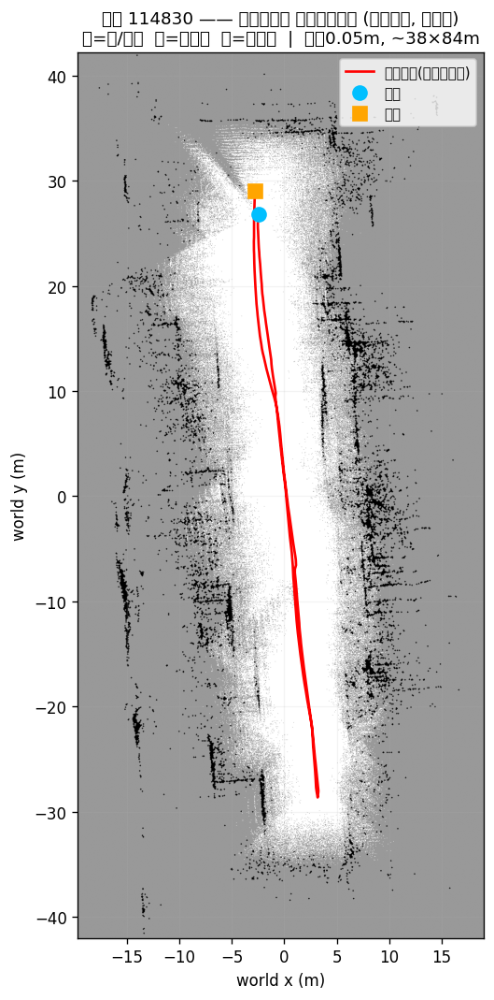

# BEV 是怎么做出来的 —— NAVSIM 的做法 & 我们只有深度怎么做

> 更新 2026/07/07。讲清楚喂给 DiffusionDrive 的那张 BEV（`lidar_feature`, 1×256×256）到底怎么生成：
> ① NAVSIM/DiffusionDrive 官方怎么做；② 我们只有 ZED 深度、没有 LiDAR，怎么做出**格式完全一致**的 BEV；③ 两者的真实差异。
> 对齐代码：`robot_orig_code/DiffusionDrive-main/navsim/agents/diffusiondrive/{transfuser_features.py, transfuser_config.py}`、`robot_bev_sim/sim_bev.py`、`robot_orig_code/robot_data_prep/bev.py`。

---

## 0. 一句话（关键纠正）

**BEV 不是从图像转出来的**。DiffusionDrive 的 BEV 输入（`lidar_feature`）是 **LiDAR 点云的俯视 2D 直方图**——把点云投到地面网格，**数每个格子里落了几个点**，再归一化。相机图像是**另一路独立输入**，两者在网络 backbone 里才融合。

所以"从图像怎么转 BEV"这个问法本身是错的；正确的是"**从点云怎么数出 BEV**"。我们没有 LiDAR，但 **ZED 深度能生成度量点云**，喂进**同一个函数**就得到同格式的 BEV。

---

## 1. NAVSIM / DiffusionDrive 怎么做 BEV

### 1.1 模型的三路输入（BEV 只是其中一路）
`transfuser_features.py::compute_features`：

| 输入 | 形状 | 来源 |
|---|---|---|
| `camera_feature` | 3×256×1024 | 三目/前视图裁剪拼接 |
| **`lidar_feature`（BEV）** | **1×256×256** | **LiDAR 点云俯视直方图** |
| `status_feature` | 8 | 状态向量 |

### 1.2 BEV 生成算法 `_get_lidar_feature` / `splat_points`
`transfuser_features.py:77`，步骤：

1. 取最后一帧 LiDAR 点云 `(N,3)` = (x,y,z)，米制；
2. **按高度切层**：去掉高于车顶的点（z > `max_height_lidar`）；`z > lidar_split_height` 的算"障碍层"，地面层默认丢弃（`use_ground_plane=False`）；
3. 把障碍层的 `(x,y)` 丢进 `np.histogramdd`，网格范围 ±32m、每米 4 像素 → **256×256** 格；
4. 每格点数**封顶** `hist_max_per_pixel=5`，再 **除以 5 归一到 0~1**；
5. 输出 `(1, 256, 256)` float 张量。

就是一张**俯视占据密度图**：格子越亮 = 该位置落的点越多 = 越可能有障碍。

### 1.3 参数（`transfuser_config.py`）
| 参数 | 值 | 含义 |
|---|---|---|
| `lidar_min/max_x/y` | ±32 m | BEV 覆盖范围（车前后左右各 32m） |
| `pixels_per_meter` | 4.0 | 分辨率 → (32-(-32))×4 = **256** 格 |
| `hist_max_per_pixel` | 5 | 每格点数封顶（防个别格爆值） |
| `lidar_split_height` | 0.2 m | 高于此算障碍 |
| `use_ground_plane` | False | 只用障碍层（1 通道） |
| `max_height_lidar` | 100 m | 高于此的点丢弃 |

---

## 2. 我们只有 ZED 深度，怎么做出同样的 BEV

**思路**：ZED 深度 → 度量点云 → 变换到车体(ego)系 → **喂同一个直方图函数** → 同格式 1×256×256。
实现在 `robot_bev_sim/sim_bev.py`（`arch_e2e/pipeline/sim_bev.py` 是同款 vendored 版）。用的直方图函数 `robot_data_prep/bev.py::points_to_bev_tensor` 与 NAVSIM `_get_lidar_feature` 是**同一套逻辑**，所以输出格式与原始 DiffusionDrive **完全一致**。

### 2.1 ZED 深度点云 → ego 系（`depth_npz_to_ego`）
- ZED 存的点云 npz（键 `xyzrgba`，单位 **mm**）→ 取 xyz、去 NaN、**/1000 转米**；
- 相机系 → ego 系 remap：`ego = [z, -x, -y]`（相机 z 前 → ego x 前；相机 x 右 → ego y 左取负；相机 y 下 → ego z 上取负）。

### 2.2 生成 BEV（`official_lidar_feature`）
```python
# ego点云 → 官方直方图 → [1,256,256] float 0~1
official_lidar_feature(ego_xyz, lidar_range=32.0)   # =points_to_bev_tensor(同NAVSIM参数)
```
- `lidar_range=32` → 完全对齐原始 ckpt 的 ±32m；
- **室内建议 `lidar_range=4~6`**（±32m 对室内太大，点云挤在中间一条缝，见 §3）；但**改 range 就得重训**（ckpt 是按 ±32m 训的）。

### 2.3 与 NAVSIM 的唯一区别
**只是点从哪来**：NAVSIM 是 360° 机械 LiDAR，我们是 ZED 深度反投的点云。**格式、算法、参数、输出张量全一样**——所以能直接喂 DiffusionDrive。

---

## 3. 真实数据对比（同一函数，两种点源）

`_real_bev_compare.py` 用真实数据各跑一遍（图见 [`assets/_real_bev_compare.png`](assets/_real_bev_compare.png)）：



| | 真实 NAVSIM LiDAR | 我们真实 ZED 深度 |
|---|---|---|
| 点数 | 98,467 | 776,335 |
| 覆盖 | **360° 环视**，x∈[-178, 210]m | **只有正前方一个锥**，x∈[0.4, 20]m（后方/两侧全黑） |
| ±32m BEV | 四面八方都有结构，格子填满 | 点挤在中间一条缝，大半格子空 |
| ±6m BEV（室内尺度） | — | 前向锥填得起来，能看出走廊两壁 |

### ⭐ 核心结论：差异是**视场覆盖**，不是分辨率/算法
- NAVSIM 环视稠密 vs 我们前向锥——这是**物理视场差异**，调参救不了。
- **复用现成 ckpt** → BEV 必须保持 **±32m**（否则喂给它一张训练分布外的稀疏图）；
- **转室内 ±4~6m** 表达更好，但**必须重训**；
- 补前向锥"后方全黑"的办法：用**多帧重建的融合占据栅格**（`sim_bev.py::OccBEV`，log-odds 多帧累积）拼出更接近环视的干净 BEV，再 ego 裁窗喂模型（见 §3.5）。

---

## 3.5 ⭐ 单帧到底能做多好，瓶颈在哪（结论：卡在**位姿**，不是深度）

我们试了单帧 ZED 深度→BEV 的**多种做法**，都不理想：
- **点数直方图**（NAVSIM `splat_points` 那套）：只标命中点、其余全黑，稠密深度还 saturate → 分不清空闲/未知；
- **逆传感器模型+光线投射**（手搓 + Open3D 官方 `carve_depth_map` 空间雕刻，`bev_study/scripts/`）：能出"白=可通行扇区 / 黑=墙 / 灰=未知"，比直方图强，但仍是**一个窄前向锥 + 麻边**。

**关键结论：这不是算法或深度质量的问题，是单帧信息量 + 位姿的问题。**
1. **ZED 单帧深度本身是好的**（NEURAL 稠密度量）——你没记错；
2. 但单帧只有**前方一个锥**（横向仅 ~3m），要饱满必须**多帧融合**；
3. 多帧融合**要准位姿**。我们这批数据的位姿是**离线 VGGT 估计、有漂移**——硬堆多帧点云会因漂移累积成一坨（`short_window_bev` 实测）。之所以全局图还行，是 `OccBEV` 用 **log-odds 概率融合**平均掉了噪声/漂移：



> 走廊 114830，log-odds 多帧融合（世界系 ~38×84m，0.05m 栅格）：黑=墙、白=可通行、灰=未观测、红=轨迹。清晰长走廊 + 顶部 T 路口。这是**offline 用漂移位姿能做到的上限**。

**根因 = [数据采集规范](数据采集规范_0707.md) 的头号缺口 C**：采集时**没开 ZED positional tracking、没录 .svo、没录 /odom**，所以只有漂移的离线位姿。深度是好料，缺的是把它们对齐的**准位姿**。

### 正确做法（2026 该有的）
- **ZED SDK 自带 `spatial mapping` + `positional tracking`**：边走边在设备上实时融合出干净网格/占据图——本就是为这件事设计的。采集时开启（或录 `.svo` 事后回放），ZED 稠密深度就能融出**又干净又饱满**的 BEV。
- **或**录 `/odom`（轮式+IMU 里程计）给离线融合用准位姿。
- 有准位姿后，再以自车为中心裁窗（±6m、朝前=上）= 喂模型的那张 BEV。
- ⚠️ 但 **FoV 仍前向**：融合补"走过的地方"，没走到/没转头看的（墙背面）补不上 → 靠绕拍/回环（采集规范 D）。

**一句话**：单帧 = 窄锥（物理下限）；要好 BEV 得**多帧融合 + 准位姿**；准位姿靠 ZED 实时建图或录 odom——这是采集端要补的，不是算法能救的。

---

## 4. 复现（脚本/输出都在 `robot_bev_sim/bev_study/`）

```
bev_study/
├── scripts/
│   ├── _navsim_bev_demo.py        # NAVSIM 机制演示(合成点云跑 splat 逻辑)
│   ├── _real_bev_compare.py       # 真实 NAVSIM pcd vs 真实 ZED 深度(同一 points_to_bev_tensor)
│   ├── ism_bev_singleframe.py     # 单帧: 逆传感器模型+光线投射(手搓)
│   ├── open3d_carve_bev.py        # 单帧: Open3D 官方 carve_depth_map 空间雕刻(⚠️三个坑见文件注释)
│   ├── short_window_bev.py        # 短窗多帧融合(暴露漂移位姿硬堆的问题)
│   └── corridor_global_bev.py     # 全局 log-odds 融合走廊图(offline 上限)
├── outputs/*.png                  # 对应出图
└── data/navsim_sample/*.pcd       # OpenScene 镜像流式抽的 1 帧真实 NAVSIM 点云
```
- 我们 ZED 深度：`robot_orig_code/20260421_101905/` 与 `robot_bev_sim/data/114830/pointcloud/zed/*.npz`。
- BEV 生成实现：`robot_bev_sim/sim_bev.py`（`official_lidar_feature` / `depth_npz_to_ego` / `OccBEV`）。
- 走廊融合占据 + 逐帧位姿：`outputs/bev_logodds_114830.npz`、`outputs/feeder_poses_114830.npz`（Rot=cam→world重力对齐, Tr=世界相机中心, `world=Rot@p_cam(米)+Tr`）。

---

*代码对齐：`transfuser_features.py::_get_lidar_feature`(:77)、`transfuser_config.py`(±32m/4px/hist5/split0.2)、`robot_data_prep/bev.py::points_to_bev_tensor`、`robot_bev_sim/sim_bev.py`。*
